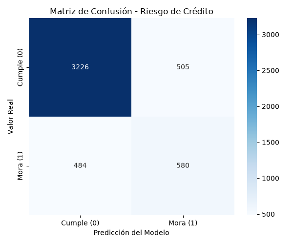
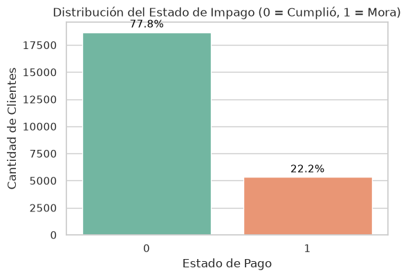
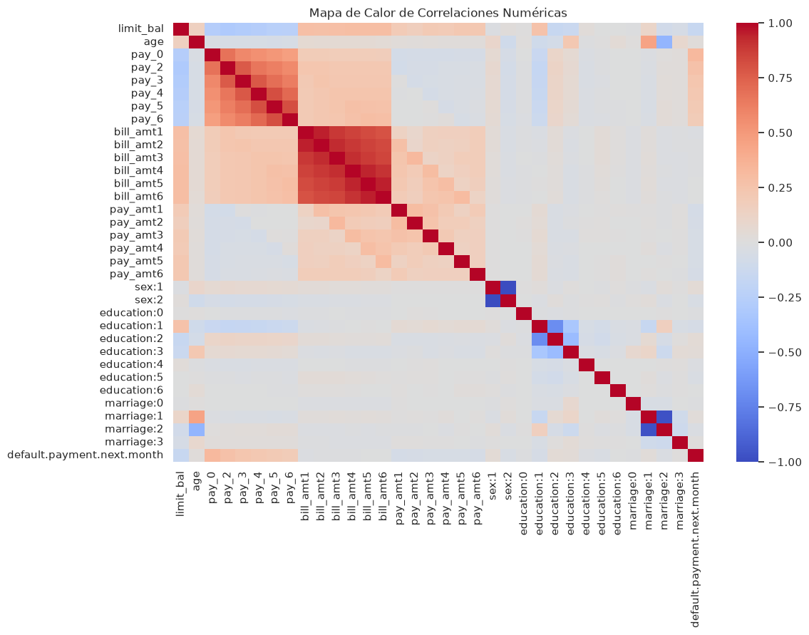

# 💳 Clasificación de Riesgo de Crédito - Pipeline Automático de Machine Learning

Este repositorio contiene un pipeline modular y automatizado de Machine Learning de extremo a extremo (End-to-End) diseñado para predecir el riesgo de mora en el pago de tarjetas de crédito. La solución sigue buenas prácticas de arquitectura de software, MLOps, orquestación centralizada e Integración Continua (CI/CD) mediante GitHub Actions.

---

## 👥 Integrantes del Proyecto

* **Rober Andrés Castillo**
* **Oscar Javier García García**

---

## 🎯 0. Pregunta de Negocio y Dataset

### Pregunta de Negocio Formulada
> **¿Qué clientes tienen una alta probabilidad de incurrir en mora el próximo mes, para que el área de riesgos priorice la aprobación, la mitigación del cupo o la cobranza preventiva?**

* **¿Quién se beneficia?:** La Vicepresidencia de Riesgos, el Área de Crédito y la Gerencia de Cobranzas de la institución financiera.
* **¿Qué decisión apoya?:**
  1. **Aprobación Automática:** Clientes con bajo riesgo predicho obtienen aprobación inmediata de su tarjeta de crédito.
  2. **Rechazo o Mitigación:** Solicitantes clasificados como de alto riesgo son rechazados o ajustados a cupos reducidos con mayor exigencia de garantías.
  3. **Cobranza Preventiva:** Priorización de contactos y recordatorios de pago para clientes activos identificados con alto riesgo de mora antes del vencimiento.

### Identificación y Justificación del Dataset
* **Dataset fuente:** [`imodels/credit-card`](https://huggingface.co/datasets/imodels/credit-card), hospedado en Hugging Face Hub.
* **Volumen:** 24.000 registros iniciales y 34 columnas en la configuración `train`; después de eliminar 25 duplicados quedan 23.975 registros.
* **Variable objetivo (`target`):** `default.payment.next.month` (0 = cumplió con el pago, 1 = incurrió en mora).
* **Justificación del Dataset:** Permite responder la pregunta de negocio porque reúne el historial real de comportamiento de pago (`PAY_0` a `PAY_6`), montos de facturación (`BILL_AMT`) y montos pagados (`PAY_AMT`), capturando la dinámica financiera previa al impago.

---

## 🧠 1. Preprocesamiento y Control de Data Leakage

* **Limpieza y Deduplicación:** Se eliminaron 25 filas duplicadas. No se encontraron valores nulos ni variables categóricas que requirieran codificación; las 33 predictoras son numéricas.
* **División de Datos (Train/Test Split):** Se realizó una separación estratificada del 80% para entrenamiento (19.180 muestras) y 20% para prueba (4.795 muestras), preservando la proporción original de la clase objetivo.
* **Control de Data Leakage:** La estandarización con `StandardScaler` ajustó sus parámetros (`fit_transform`) exclusivamente sobre el conjunto de entrenamiento y aplicó la transformación (`transform`) sobre el conjunto de prueba. Aunque Random Forest no requiere escalado para separar nodos, se conserva para dejar las variables en una escala comparable y mantener un pipeline reproducible; no cambia el criterio de división del árbol.
* **Evidencia reproducible:** El resumen generado en [`informes/resumen_ejecucion.txt`](informes/resumen_ejecucion.txt) contiene el esquema y tipos, una muestra del DataFrame, nulos y duplicados antes/después, distribución de clases y comparación de configuraciones.

---

## 🌳 2. Selección del Modelo y Explicación Teórica

### Modelo Seleccionado: `RandomForestClassifier` (Aprendizaje Supervisado)
Se eligió un enfoque de **Aprendizaje Supervisado de Clasificación Binaria** debido a que el problema busca predecir una variable categórica etiquetada (`0` o `1`).

### ¿Cómo funciona Random Forest paso a paso?
Random Forest es un algoritmo de ensamble basado en múltiples Árboles de Decisión (`Bagging` / *Bootstrap Aggregating*):

1. **Muestreo Bootstrap:** El algoritmo crea múltiples subconjuntos de datos aleatorios a partir del conjunto de entrenamiento original, tomando muestras con reemplazo.
2. **Construcción de Árboles (Random Subspace):** Para cada subconjunto, se entrena un Árbol de Decisión individual. En cada división de un nodo, el árbol no evalúa todas las variables, sino un subconjunto aleatorio de características (típicamente la raíz cuadrada del número total de variables). Esto evita que árboles individuales dominen el modelo y descorrelaciona las decisiones.
3. **Predicción Individual:** Cada árbol de la estructura emite una predicción independiente (0 = Cumplido, 1 = Moroso).
4. **Votación Mayoritaria:** El modelo combina las predicciones de todos los árboles y asigna la clase final mediante la votación de la mayoría simple.

### Significado de los Parámetros Utilizados
* `n_estimators=100`: Define que el bosque construirá 100 árboles de decisión independientes, logrando estabilidad en las predicciones.
* `max_depth=15`: Limita la profundidad máxima de cada árbol a 15 niveles para capturar relaciones no lineales sin permitir árboles ilimitados.
* `random_state=42`: Fija la semilla aleatoria para asegurar la reproducibilidad exacta en cualquier entorno de ejecución.
* **Selección de configuración:** Se compararon `n_estimators` 50/100 y `max_depth` 8/10/15 mediante una validación estratificada interna del conjunto de entrenamiento. La prueba final se reservó para evaluar una sola vez la configuración elegida.

### Ventajas y Limitaciones
* **Ventajas:** Alta precisión, gran resistencia al sobreajuste, capacidad de capturar relaciones no lineales y evaluación de importancia de variables.
* **Limitaciones:** Mayor consumo de memoria RAM en comparación con un solo árbol y menor interpretabilidad directa frente a modelos lineales.

---

## 🏗️ Arquitectura del Repositorio

```text
ml-riesgo-credito/
├── .github/
│   └── workflows/
│       └── ml_pipeline.yml     # Workflow de CI/CD automatizado en GitHub Actions
├── jupyter/
│   └── 01_exploracion.ipynb    # Análisis Exploratorio de Datos (EDA) con gráficos
├── src/                        # Módulos Python reutilizables
│   ├── ingesta.py              # Descarga de datos desde Hugging Face
│   ├── preprocesamiento.py     # Limpieza, deduplicación, split estratificado y escalado
│   ├── modelo.py               # Configuración y entrenamiento de RandomForest
│   └── evaluacion.py           # Cálculo de métricas y generación del gráfico seaborn
├── informes/                   # Artefactos generados automáticamente por main.py
│   ├── matriz_confusion.png    # Mapa de calor de aciertos y errores
│   ├── resumen_ejecucion.txt   # Ficha técnica, tiempos de corrida y métricas
│   └── hallazgos.md            # Informe ejecutivo de impacto de negocio
├── main.py                     # Orquestador principal del pipeline
├── requirements.txt            # Dependencias del proyecto
└── README.md                   # Documentación principal
```

## 📈 3. Resultados y Métricas de Evaluación

En la ejecución del conjunto de prueba (4.795 muestras no vistas durante el entrenamiento), el modelo obtuvo los siguientes resultados:

| Métrica | Valor obtenido | Interpretación de negocio |
| :--- | :---: | :--- |
| **Accuracy (Exactitud)** | **81,69 %** | Clasificación correcta general de clientes cumplidos y morosos. |
| **Precision (Precisión)** | **67,10 %** | De cada 100 clientes marcados con riesgo de mora, aproximadamente 67 realmente incurrieron en impago. |
| **Recall (Sensibilidad)** | **34,30 %** | Porcentaje de clientes morosos reales detectados a tiempo por el modelo. |
| **F1-Score** | **45,40 %** | Balance armónico entre la precisión y la sensibilidad frente a la clase minoritaria. |

### Análisis Financiero de la Matriz de Confusión

1. **Falsos negativos (riesgo crítico):** representan clientes morosos que el modelo aprobó como cumplidos. Producen pérdida directa de capital, gastos de cobranza y cartera castigada.
2. **Falsos positivos (costo de oportunidad):** representan clientes cumplidos rechazados por error. Producen pérdida de ingresos por intereses no percibidos.

## 📉 Matriz de Confusión

La siguiente matriz resume los aciertos y errores del modelo sobre el conjunto de prueba:



## 📓 Exploración de Datos (EDA)

El análisis exploratorio visual se encuentra documentado en el notebook [`jupyter/01_exploracion.ipynb`](jupyter/01_exploracion.ipynb).

### Gráficas del análisis exploratorio

#### Distribución del estado de impago



#### Mapa de calor de correlaciones numéricas



## 💻 Guía de Instalación y Ejecución Local

### 1. Requisitos previos

- Python 3.10 o superior.
- Gestor de paquetes `pip` e interfaz de línea de comandos (Bash/Terminal).

### 2. Clonar el repositorio y crear el entorno virtual

```bash
git clone https://github.com/nickend12/ml-riesgo-credito.git
cd ml-riesgo-credito

python3 -m venv .venv
source .venv/bin/activate
```

### 3. Instalar dependencias

```bash
pip install --upgrade pip
pip install -r requirements.txt
```

### 4. Ejecutar el pipeline completo (orquestador)

```bash
python main.py
```

### Simulador interactivo en tiempo real

Después de ejecutar el pipeline, inicia la aplicación local:

```bash
streamlit run app.py
```

La aplicación permite ingresar los datos de un cliente y consultar la probabilidad
estimada de mora. Revisa cada dos segundos los archivos generados en `informes/`;
al volver a ejecutar `python main.py`, recarga automáticamente el modelo, las
métricas y el resumen mostrado en pantalla. También muestra una gráfica de barras
con las métricas actuales, la matriz de confusión y un gráfico de líneas con los
cambios observados entre ejecuciones durante la sesión.

### 5. Ejecución individual de módulos (pruebas unitarias)

```bash
# Test de ingesta
python -m src.ingesta

# Test de preprocesamiento
python -m src.preprocesamiento

# Test de entrenamiento
python -m src.modelo

# Test de evaluación
python -m src.evaluacion
```

## ⚙️ 5. Integración Continua (CI/CD) en GitHub Actions

El archivo [`.github/workflows/ml_pipeline.yml`](.github/workflows/ml_pipeline.yml) garantiza la automatización y la integración continua del proyecto:

- **Disparadores:** se activa automáticamente ante cualquier `push` o `pull_request` enviado a la rama `main`. También puede ejecutarse manualmente.
- **Ambiente virtual:** despliega un servidor `ubuntu-latest` con Python 3.10.
- **Flujo de pasos:**

1. Descarga el código fuente del repositorio (`actions/checkout@v4`).
2. Configura el entorno Python e instala las dependencias (`requirements.txt`).
3. Ejecuta `python main.py` para validar la integridad del pipeline.
4. Empaqueta los artefactos de la carpeta `informes/` (`matriz_confusion.png`, `resumen_ejecucion.txt` y `hallazgos.md`) y los publica como un paquete descargable (`ml-reports`) mediante `actions/upload-artifact@v4`.

### Ejecución exitosa de referencia

La ejecución final publicada en GitHub Actions terminó correctamente y dejó disponible el artefacto `ml-reports`:

[Ver ejecución exitosa del workflow](https://github.com/nickend12/ml-riesgo-credito/actions/runs/40628689613)
