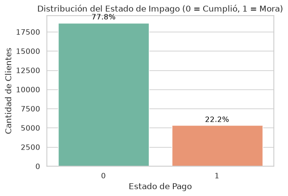
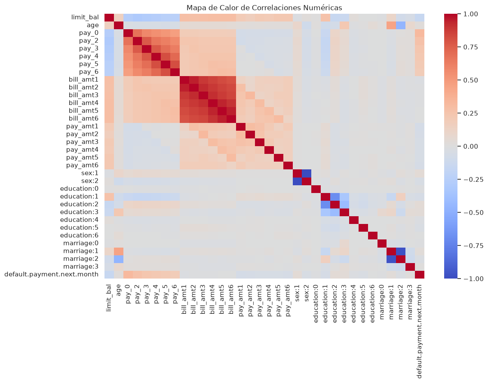
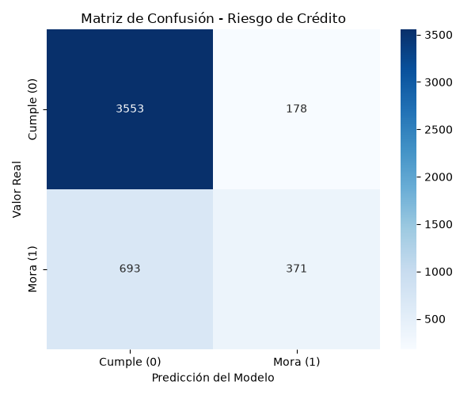

# 💳 Clasificación de Riesgo de Crédito - Pipeline Automático de Machine Learning

Este repositorio contiene un pipeline modular y automatizado de Machine Learning de extremo a extremo (End-to-End) diseñado para predecir el riesgo de mora en el pago de tarjetas de crédito. La solución sigue buenas prácticas de arquitectura de software, MLOps, orquestación centralizada e Integración Continua (CI/CD) mediante GitHub Actions.

---

## 👥 Integrantes del Proyecto

* **Rober Andrés Castillo**
* **Oscar Javier García García**

---

## 📊 Dataset y Problema de Negocio

El objetivo de este proyecto es ayudar a las instituciones financieras a tomar decisiones automatizadas en la aprobación de crédito, mitigando la cartera vencida sin restringir innecesariamente la colocación de productos financieros.

* **Dataset fuente:** [`imodels/credit-card`](https://huggingface.co/datasets/imodels/credit-card), hospedado en Hugging Face Hub.
* **Volumen:** 24.000 registros iniciales y 34 columnas.
* **Variable objetivo (`target`):** `default.payment.next.month` (0 = cumplió con el pago, 1 = incurrió en mora).
* **Algoritmo seleccionado:** `RandomForestClassifier` (Scikit-Learn), configurado con `n_estimators=100`, `max_depth=10` y `random_state=42` para garantizar la reproducibilidad.
* **Control de data leakage:** `StandardScaler` ajusta sus parámetros (`fit_transform`) exclusivamente sobre el conjunto de entrenamiento (19.180 muestras) y aplica la transformación (`transform`) sobre el conjunto de prueba (4.795 muestras).

---

## 🏗️ Arquitectura del Repositorio

```text
ml-riesgo-credito/
├── .github/
│   └── workflows/
│       └── ml_pipeline.yml     # Workflow de CI/CD automatizado en GitHub Actions
├── jupyter/
│   └── 01_exploracion.ipynb   # Análisis Exploratorio de Datos (EDA) con gráficos
├── src/                        # Módulos Python reutilizables
│   ├── ingesta.py              # Descarga de datos desde Hugging Face
│   ├── preprocesamiento.py     # Limpieza, deduplicación, split estratificado y escalado
│   ├── modelo.py               # Configuración y entrenamiento de RandomForest
│   └── evaluacion.py           # Cálculo de métricas y generación del gráfico seaborn
├── informes/                   # Artefactos generados automáticamente por main.py
│   ├── matriz_confusion.png    # Mapa de calor de aciertos y errores
│   ├── resumen_ejecucion.txt   # Ficha técnica, tiempos de corrida y métricas
│   └── hallazgos.md            # Informe ejecutivo de impacto de negocio
├── main.py                     # Orquestador principal del pipeline
├── requirements.txt            # Dependencias del proyecto
└── README.md                   # Documentación principal
```

## 📈 Resultados y Métricas de Evaluación

En la ejecución del conjunto de prueba (4.795 muestras no vistas durante el entrenamiento), el modelo obtuvo los siguientes resultados:

| Métrica | Valor obtenido | Interpretación de negocio |
| :--- | :---: | :--- |
| **Accuracy (Exactitud)** | **81,50 %** | Clasificación correcta general de clientes cumplidos y morosos. |
| **Precision (Precisión)** | **66,20 %** | De cada 100 clientes marcados con riesgo de mora, 66 realmente incurrieron en impago. |
| **Recall (Sensibilidad)** | **36,50 %** | Porcentaje de clientes morosos reales detectados a tiempo por el modelo. |
| **F1-Score** | **47,10 %** | Balance armónico entre la precisión y la sensibilidad frente a la clase minoritaria. |

### Análisis Financiero de la Matriz de Confusión

1. **Falsos negativos (riesgo crítico):** representan clientes morosos que el modelo aprobó como cumplidos. Producen pérdida directa de capital, gastos de cobranza y cartera castigada.
2. **Falsos positivos (costo de oportunidad):** representan clientes cumplidos rechazados por error. Producen pérdida de ingresos por intereses no percibidos.

## 💻 Guía de Instalación y Ejecución Local

### 1. Requisitos previos

* Python 3.10 o superior.
* Gestor de paquetes `pip` e interfaz de línea de comandos (Bash/Terminal).

### 2. Clonar el repositorio y crear el entorno virtual

```bash
git clone https://github.com/nickend12/ml-riesgo-credito.git
cd ml-riesgo-credito

python3 -m venv .venv
source .venv/bin/activate
```

### 3. Instalar dependencias

```bash
pip install --upgrade pip
pip install -r requirements.txt
```

### 4. Ejecutar el pipeline completo (orquestador)

Para ejecutar la ingesta, el preprocesamiento, el entrenamiento, la evaluación y la generación automática de la carpeta `informes/`:

```bash
python main.py
```

### 5. Ejecución individual de módulos (pruebas unitarias)

Si deseas auditar cada etapa del pipeline por separado:

```bash
# Test de ingesta
python -m src.ingesta

# Test de preprocesamiento
python -m src.preprocesamiento

# Test de entrenamiento
python -m src.modelo

# Test de evaluación
python -m src.evaluacion
```

## 📓 Exploración de Datos (EDA)

El análisis exploratorio visual se encuentra documentado en el notebook [`jupyter/01_exploracion.ipynb`](jupyter/01_exploracion.ipynb).

1. Abre Visual Studio Code o Jupyter Lab.
2. Selecciona el kernel asociado al entorno virtual `.venv`.
3. Ejecuta todas las celdas para visualizar la distribución de la variable objetivo, los gráficos de correlación y la detección de valores atípicos.

### Gráficas del análisis exploratorio

#### Distribución del estado de impago



#### Mapa de calor de correlaciones numéricas



## 📉 Matriz de Confusión

La siguiente matriz resume los aciertos y errores del modelo sobre el conjunto de prueba:



## ⚙️ Integración Continua (CI/CD) en GitHub Actions

El archivo [`.github/workflows/ml_pipeline.yml`](.github/workflows/ml_pipeline.yml) garantiza la automatización y la integración continua del proyecto:

* **Disparadores:** se activa automáticamente ante cualquier `push` o `pull_request` enviado a la rama `main`. También puede ejecutarse manualmente.
* **Ambiente virtual:** despliega un servidor `ubuntu-latest` con Python 3.10.
* **Flujo de pasos:**
  1. Descarga el código fuente del repositorio (`actions/checkout@v4`).
  2. Configura el entorno Python e instala las dependencias (`requirements.txt`).
  3. Ejecuta `python main.py` para validar la integridad del pipeline.
  4. Empaqueta los artefactos de la carpeta `informes/` (`matriz_confusion.png`, `resumen_ejecucion.txt` y `hallazgos.md`) y los publica como un paquete descargable (`ml-reports`) mediante `actions/upload-artifact@v4`.